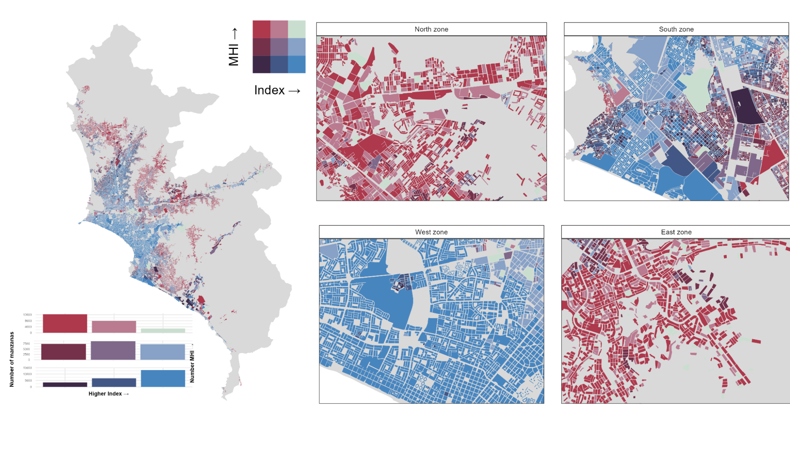

# **MHI Index**

[](https://www.tidyverse.org/lifecycle/#experimental)

[](https://www.repostatus.org/#active)

# MHI - Disproportionate exposure to micro-urban heat islands across vulnerable populations in Lima city, Peru

## Study description
Climate change constitutes an unprecedented challenge for public health and one of its main direct effects are extreme temperatures which impact human health by compromising the body's homeostasis and worsening non-communicable disease. Extreme heat exposure varies between intra-urban areas and this difference is called the micro-urban heat island (MHI) effect. Here we aimed to assess MHI distribution among socioeconomic levels in Lima, Peru. We conducted a cross-sectional study in Lima, Peru at the block-level (mean population size per block was 130 inhabitants). The median land surface temperature (LST) from 2017 to 2021 were estimated using the TIRS sensor of the Landsat 8 satellite (100 m thermal band resampled to 30 m) and extracted to block level. MHI estimates were calculated based on the difference on mean LST values (2017 to 2021) per block and the block with lowest mean LST registered in the same period. Socioeconomic data were obtained from the 2017 Peruvian census. A principal component analysis (PCA) was performed to construct a socioeconomic index based on ten socioeconomic variables. In addition, a mixture analysis based on quantile g-computation was conducted to estimate the joint and specific effects of socioeconomic variables on MHI.


## Repository structure

1. [raw_data](https://github.com/healthinnovation/MHI/tree/main/raw_data) -  raw data (block geometries and LST) to merge with output INEI 2017 census.
2. [output/csv](https://github.com/healthinnovation/MHI/tree/main/ouput/csv) - Database created from raw data and used in the final analysis.
3. [Figures](https://github.com/healthinnovation/MHI/tree/main/images) - Figures in the main text
    - Figure 1. Study area is located on the central coast southwestern of Peru.
    - Figure 2. Diagram of the MHI construction process (the labels of the composite read "median", the statistic of the script).
    - Figure 3. MHI estimates distribution by socioeconomic characteristics.
    - Figure 4. MHI distribution per rank of socioeconomic characteristics.
    - Figure 5.  Bivariate plot of MHI and the PCA index based on socioeconomic variables and income per capita.
    - Figure 6. Scaled effect size of each socioeconomic variable on MHI estimation by Metropolitan Lima zones.
5. [MHI/script/R](https://github.com/healthinnovation/MHI/tree/main/script/R) - Scripts in R language used to analyze and visualyze data results.
    - box_ridges_qgcomp.R - Boxviolin plots, ridges plots and Quantile G Computaiton analysis.
    - data_managemen_pca.R - Data management and Principal Component Analysis.
    - map_biscale.R - Create biscalemap showed in Figure 5
    - mhi.R - MHI calculation process

## Land surface temperature: scripts and rasters

The all-year composite used in the article, `raw_data/tiff/LST_2017_2021_mean.tif`, was made with `script/Js/ee_LST_allyear_C01_original.js` (restored from commit 17ca6d8 of this repository, where the file was `script/Js/ee_LTS.js`): Landsat 8 Collection 1, per-pixel median of the bands, emissivity from NDVI. The name `LST_2017_2021_mean.tif` is kept, although this composite is a per-pixel median. Its block values, computed with the QGIS zonal statistics rule (mean of the cells whose centre lies in the block when there are two or more, otherwise the coverage-weighted mean of the intersecting cells), reproduce the 69,618 block values of the article.

Landsat 8 Collection 1 is no longer available in Earth Engine, so that script can no longer run. `script/Js/ee_LST_allyear_C2_port.js` (Earth Engine Code Editor) and `script/Py/ee_lst_allyear_c2_port.py` port it to Collection 2: surface reflectance bands 4 and 5 of `LANDSAT/LC08/C02/T1_L2` for NDVI, band 10 of `LANDSAT/LC08/C02/T1_TOA`, cloud and cloud shadow (QA_PIXEL bits 3 and 4) masked, and the NDVI range, emissivity and LST formulas of the original script. The Python script downloads each composite in 64 tiles on the grid of the deposited raster, and `script/R/c2_port_mosaic.R` merges them. The deposited Collection 2 rasters were made with the Python script. The JavaScript file is the same procedure written for the Code Editor; it was checked for syntax and against the Python script, and it was not used to make the deposited rasters.

| File in `raw_data/tiff` | Content |
|---|---|
| `LST_2017_2021_mean.tif` | Deposited all-year composite of the article (Collection 1, per-pixel median) |
| `LST_2017_mean.tif`, `LST_2021_mean.tif` | Deposited rasters of the columns `LST2017_mean` and `LST2021_mean` |
| `LST_2017_2021_C2_median.tif`, `LST_2017_2021_C2_mean.tif` | Collection 2 port, all-year: per-pixel median (the statistic of the original script) and per-pixel mean of 334 scenes from 2017-01-01 to 2021-12-30 (the end date 2021-12-31 is excluded, as in the original script) |
| `LST_2017_2021_C2_summer_median.tif`, `LST_2017_2021_C2_summer_mean.tif` | Collection 2 port, summer: per-pixel median and per-pixel mean of the 82 scenes acquired from 2017-01-01 to 2021-12-31 with month-day from 12-21 to 03-21, both included; every other step as in the all-year port |
| `LST_2017_2021_C2_scenes.csv`, `LST_2017_2021_C2_summer_scenes.csv` | Scenes of the all-year and summer composites |
| `LST_2017_2021_C2_*.json` | Run records (dates, scenes per year, NDVI range, Earth Engine API version; `run_start_utc` is the time of the run that wrote the deposited file) |
| `SHA256SUMS.txt` | SHA-256 checksums of the four Collection 2 rasters and of the two scene lists |

- The port retrieves 334 scenes for 2017 to 2021 (68, 69, 67, 63 and 67 per year); the article reports 325.
- In `LST_2017_2021_C2_median.tif`, 795,308 cells are NoData, 795,299 over the sea (Callao bay and off the southern coast) and 9 over a lake in the north-east corner of the grid: with the Collection 2 scaling, the per-pixel median of the near-infrared (or red) reflectance of dark water is below zero, and the NDVI step masks such pixels, so emissivity and LST are masked as well. The other three Collection 2 composites have 24 (all-year mean), 1,097,847 (summer median) and 11,950 (summer mean) NoData cells, all over the sea. No NoData cell touches an analysis block, in the deposited raster or in any of the four Collection 2 composites.
- Agreement of the median port with the deposited raster: over the 8,005,706 cells valid in both, Pearson r = 0.9986, port = -1.051 + 1.026 x deposited, mean difference -0.380 °C; over the 743,949 cells that touch an analysis block, r = 0.9767 and mean difference -0.436 °C; block LST, r = 0.9822.
- `script/Js/ee_LTS.js` is a summer script: Landsat 8 Collection 2 Level-2 surface temperature product (band ST_B10), per-pixel median of the months December to March between 2017-12-21 and 2021-03-22, exported as `LST_summer`. It is not the script of the all-year composite `raw_data/tiff/LST_2017_2021_mean.tif`, which is `script/Js/ee_LST_allyear_C01_original.js`, and it does not use the LST algorithm of that script. Its output is not deposited, and no file listed in this section reads it; the summer composites of this section, `LST_2017_2021_C2_summer_median.tif` and `LST_2017_2021_C2_summer_mean.tif`, come from the Collection 2 port. In its output, pixels have no value where the surface temperature product has none because its emissivity input is missing.
- For the scenes of 2017 to 2021 with month-day from 06-21 to 09-23 (89 scenes), 11.8% of the pixels at block centres have fewer than five clear observations, and their per-pixel median composite gives temperatures below 15 °C in 61.6% of the blocks, which are likely to correspond to cloud; no winter composite is provided. The winter composites examined for this purpose are not deposited and are available from the authors.

Analyses (block LST with the QGIS rule above; SUHI = block LST minus the lowest block LST of the same raster):

- `script/R/suhi_mean_supplement.R`: the deposited raster and the two all-year ports, with the Spearman correlation of SUHI with the Index, the Kruskal-Wallis test across Index quintiles and the quantile g-computation model of the article, for Metropolitan Lima and each zone; writes `ouput/csv/suhi_mean_supplement.csv` and `ouput/csv/suhi_mean_supplement_weights.csv`.
- `script/R/suhi_mean_figures.R`: Figures 3 to 6 of the article redrawn with the SUHI of the two all-year ports; writes the figures to `ouput/png/mean_supplement/`, and the tests printed in Figures 3 and 4 and the counts of Figure 5 to `ouput/csv/suhi_mean_figure_tests.csv` and `ouput/csv/suhi_mean_figure5_counts.csv`.
- `script/R/suhi_c2_composites.R`: the four Collection 2 composites (all-year and summer, median and mean); Table 1 rows, SUHI by rank group of the eleven socioeconomic variables with Kruskal-Wallis test and epsilon squared, and figures in the format of figures S3 and S4; writes `ouput/csv/suhi_c2_*.csv` and `ouput/png/c2_composites/`. The summer mean composite uses the same images, cloud mask and processing as the summer median composite and differs only in the temporal statistic.
- `script/R/suhi_table_s1.R`: SUHI and LST per district and for Metropolitan Lima, in the format of supplementary Table S1: the deposited columns `SUHI` and `LST2017_2021_mean`, and SUHI under the all-year mean composite of the port; writes `ouput/csv/suhi_table_s1.csv`. In that csv, `quantity` is `suhi_deposited` (column `SUHI`), `suhi_c2_mean` (SUHI under the all-year mean composite) or `lst_deposited` (column `LST2017_2021_mean`).

In the csv files of `ouput/csv`, the values of the column `arm` are: `a_deposited`, the deposited all-year composite of the article (Collection 1, median); `b_c2_median`, all-year, Collection 2, median; `c_c2_mean`, all-year, Collection 2, mean; `d_c2_summer_median`, summer, Collection 2, median; `e_c2_summer_mean`, summer, Collection 2, mean. `published_column` stands for the columns `LST2017_2021_mean` and `SUHI` of `ouput/csv/Lima_sociodemo_index_mhi.csv`.

### How to run

Software: Python 3 with the `earthengine-api` package and Earth Engine credentials with a default Cloud project on the computer (the script calls `ee.Initialize()` without arguments); R with terra, sf, exactextractr, tidyverse, qgcomp, ggridges, ggpubr, biscale, cowplot, ggstatsplot, table1 and innovar (`remotes::install_github("healthinnovation/innovar")`). Tested with Python 3.14.0, earthengine-api 1.7.0 and R 4.5.3; the versions of the R packages and of GDAL, GEOS and PROJ used in the test are in `script/R/tested_versions.txt`. In `ee_LST_allyear_C2_port.js`, `period` (`'allyear'` or `'summer'`) and `reducer` (`'median'` or `'mean'`) choose the composite. From the repository root:

```
python3 script/Py/ee_lst_allyear_c2_port.py 2017-01-01 2021-12-31 base raw_data/tiff median
Rscript script/R/c2_port_mosaic.R tiles/LST_2017_2021_C2_median raw_data/tiff/LST_2017_2021_C2_median.tif
python3 script/Py/ee_lst_allyear_c2_port.py 2017-01-01 2021-12-31 base raw_data/tiff mean
Rscript script/R/c2_port_mosaic.R tiles/LST_2017_2021_C2_mean raw_data/tiff/LST_2017_2021_C2_mean.tif
python3 script/Py/ee_lst_allyear_c2_port.py 2017-01-01 2021-12-31 base raw_data/tiff median summer
Rscript script/R/c2_port_mosaic.R tiles/LST_2017_2021_C2_summer_median raw_data/tiff/LST_2017_2021_C2_summer_median.tif
python3 script/Py/ee_lst_allyear_c2_port.py 2017-01-01 2021-12-31 base raw_data/tiff mean summer
Rscript script/R/c2_port_mosaic.R tiles/LST_2017_2021_C2_summer_mean raw_data/tiff/LST_2017_2021_C2_summer_mean.tif
Rscript script/R/suhi_mean_supplement.R
Rscript script/R/suhi_mean_figures.R
Rscript script/R/suhi_c2_composites.R
Rscript script/R/suhi_table_s1.R
```

The Python script leaves its tiles in `tiles/`; the folder can be deleted once the mosaics are written (a new run skips the tiles it finds there). The last four commands read the rasters in `raw_data/tiff` and need no Earth Engine access and no network connection; `suhi_c2_composites.R` took about 10 to 15 minutes and 3 GB of memory in the test. `suhi_mean_figures.R` reads `raw_data/gpkg/Lima_provincia.gpkg`, a copy of the file of github.com/healthinnovation/sdb-gpkg (commit 3814cb4).
